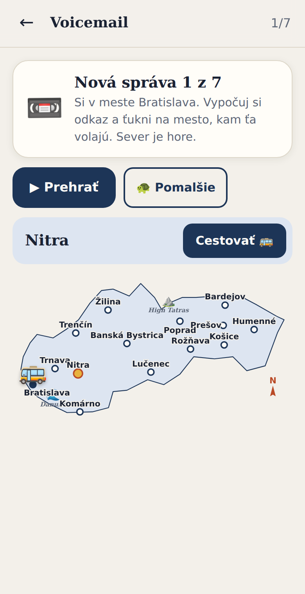
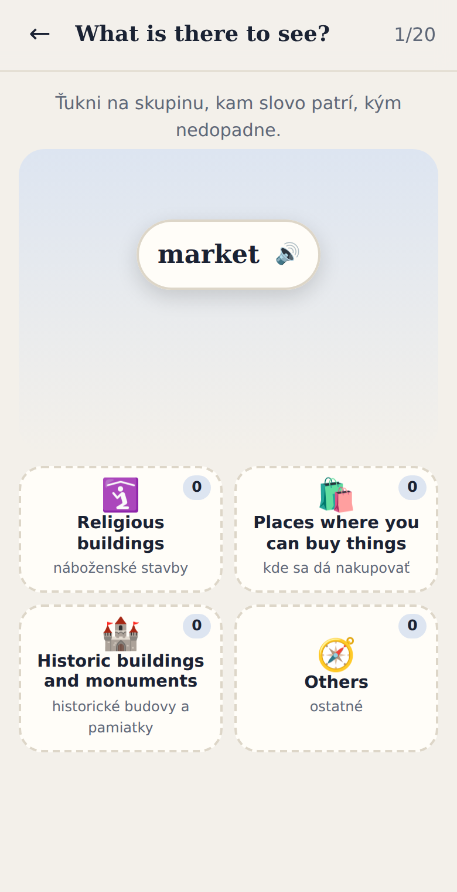
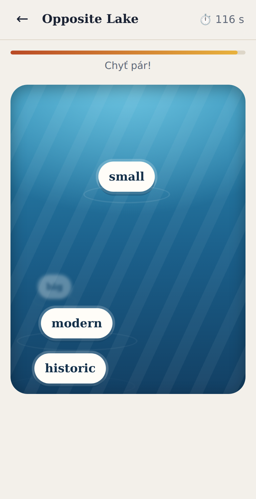

# Angličtina hrou

[](https://github.com/jurzon/anglictina/actions/workflows/validate.yml)

Angličtina pre slovensky hovoriacich žiakov: príbehy, v ktorých sa dá ťuknúť na každé slovo, a minihry ku každej lekcii z učebnice. Funguje v prehliadači na mobile aj počítači, bez inštalácie a bez registrácie.

### ▶ Hrať: https://jurzon.github.io/anglictina/

<p>
  
  
  
  
</p>

## Pre učiteľa: ako to dať žiakom


1. **Premietni QR kód** na tabuľu alebo ho vytlač (pravým tlačidlom → Uložiť obrázok). Žiaci ho naskenujú fotoaparátom v mobile.
2. Alebo im pošli odkaz **https://jurzon.github.io/anglictina/**
3. Appku si môžu pridať na plochu (v Chrome ⋮ → *Pridať na plochu*), potom sa otvára ako bežná aplikácia.

Netreba žiadne konto ani inštaláciu. Pokrok sa ukladá iba v mobile žiaka.

**Priame odkazy na hry** (napr. na domácu úlohu):
[Príbeh](https://jurzon.github.io/anglictina/#/l/u5/read/0) ·
[Tom's Birthday Surprise](https://jurzon.github.io/anglictina/#/l/u5/adventure) ·
[Voicemail](https://jurzon.github.io/anglictina/#/l/u5/walk) ·
[What is there to see?](https://jurzon.github.io/anglictina/#/l/u5/sort) ·
[Opposites](https://jurzon.github.io/anglictina/#/l/u5/pairs) ·
[Opposite Lake](https://jurzon.github.io/anglictina/#/l/u5/pond) ·
[Spell it!](https://jurzon.github.io/anglictina/#/l/u5/spell)

<br clear="right">

## Lekcie

| Lekcia | Téma | Slovná zásoba a gramatika |
|---|---|---|
| **U5** Towns and cities | Pohľadnice zo Slovenska, list z Yorku | svetové strany (*north of, in the east of*), prídavné mená a opozitá (*crowded – empty*), miesta v meste (*cathedral, harbour, town hall…*) |

## Hry

- 📖 **Living story**: príbeh v kapitolách. Ťuknutím na slovo sa ukáže preklad, podčiarknuté slová skrývajú otázku a na konci kapitoly sú otázky áno/nie.
- 🧭 **Tom's Birthday Surprise** (Adventure): textová hra v Yorku. Tom má narodeniny a do 14:00 treba za 20 £ zohnať darček, kvety, tortu a pohľadnicu. Žiak píše alebo hovorí anglické príkazy (*go to the market, talk to the seller, give the cake to Tom*), rozpráva sa s postavami, ktoré vyzerajú ako Einstein, kráľovná Viktória, Shakespeare či Chaplin, nakupuje a vyjednáva, pýta sa *Where can I buy flowers?*, číta mapu s reklamami a taxikárovi (ako Charles Dickens) povie *Can you take me to the market, please?*. Odpovede kontroluje hra a pri inom znení aj AI; pri chybe vysvetlí prečo (napr. *Prečo DO?*) a dá vety na vyslovenie. Po každom rozhovore nasleduje dril, na konci blahoželanie, ktoré ohodnotí Claude. Čo žiak nevedel, vráti sa mu o 1, 3, 7, 14 a 30 dní.
- 📼 **Voicemail**: hráč počuje hlasový odkaz (text nevidí), napr. *„I'm in a city north of Prešov…“*, nájde mesto na mape a za odmenu dostane vtipný príbeh a výhru.
- 🗂️ **What is there to see?**: slovo padá a treba ho včas poslať do správnej skupiny (náboženské stavby, obchody, pamiatky, ostatné).
- 🔁 **Opposites**: spájanie opozít, každý správny pár naleje pohár, séria bez chyby robí combo.
- 🌊 **Opposite Lake**: slová sa na chvíľu vynoria z hladiny a treba chytiť pár, kým sa ponoria.
- 🔤 **Spell it!**: počúvanie hláskovania (*bee – are – eye – dee – gee – ee*), píše sa na papier alebo do appky.
- 🚦 **Karty** a 🧩 **Build the sentence**: gramatika s vysvetlením a skladanie viet.

Pokrok (hviezdy, prečítané kapitoly, séria dní, opakovanie) sa ukladá iba v prehliadači. Jediné, čo appka odosiela, je text pohľadnice v hre Adventure, a to iba keď je zapnuté AI hodnotenie (pozri [ai-proxy/README.md](ai-proxy/README.md)).

## Pre vývojárov

Čisté HTML, CSS a JavaScript bez buildu a bez závislostí (okrem voliteľného servera `ai-proxy/`).

```sh
python3 -m http.server 8000      # spustiť lokálne na http://localhost:8000
node tools/validate.mjs          # skontrolovať obsah lekcií
```

| Priečinok | Obsah |
|---|---|
| `js/` | engine, spoločný s repozitárom [taliancina](https://github.com/jurzon/taliancina) (zmeny treba preniesť aj tam) |
| `js/games/` | minihry; register je v `js/games/index.js` |
| `data/config.js` | jazyk, značka, maskot, texty hier |
| `data/index.js`, `data/unit*.js` | zoznam lekcií a ich obsah |
| `ai-proxy/` | Cloudflare Worker na AI hodnotenie písania (drží API kľúč, appka ho nevidí) |
| `tools/validate.mjs` | kontrola obsahu (beží aj automaticky na GitHube pri každom pushi) |

**Nová lekcia:** pozri [docs/lekcia.md](docs/lekcia.md).

## Fotky

Fotky v hre *Tom's Birthday Surprise* sú z [Wikimedia Commons](https://commons.wikimedia.org/) (priečinky `img/york/` a `img/people/`), použité bez úprav:

| Fotka | Autor | Licencia |
|---|---|---|
| [York railway station](https://commons.wikimedia.org/wiki/File:York_Train_Station_(56331202).jpeg) | Michael D Beckwith | [CC0](https://creativecommons.org/publicdomain/zero/1.0/) |
| [River Ouse at Lendal Bridge](https://commons.wikimedia.org/wiki/File:River_Ouse_at_Lendal_Bridge,_York_-_geograph.org.uk_-_2850983.jpg) | Chris Morgan | [CC BY-SA 2.0](https://creativecommons.org/licenses/by-sa/2.0/) |
| [Clifford's Tower](https://commons.wikimedia.org/wiki/File:York_Castle_Clifford%27s_Tower_2007.jpg) | Steven Fruitsmaak | public domain |
| [The Shambles](https://commons.wikimedia.org/wiki/File:The_Shambles,_York_-_geograph.org.uk_-_2971409.jpg) | John M Wheatley | [CC BY-SA 2.0](https://creativecommons.org/licenses/by-sa/2.0/) |
| [York Minster, west front](https://commons.wikimedia.org/wiki/File:York_Minster,_west_front_-_geograph.org.uk_-_676054.jpg) | Gordon Hatton | [CC BY-SA 2.0](https://creativecommons.org/licenses/by-sa/2.0/) |
| [Stonegate](https://commons.wikimedia.org/wiki/File:Stonegate,_York_Geograph-3484534-by-Derek-Voller.jpg) (pekáreň) | Derek Voller | [CC BY-SA 2.0](https://creativecommons.org/licenses/by-sa/2.0/) |
| [Isabella Beeton](https://commons.wikimedia.org/wiki/File:Isabella_Beeton,_by_Maull_%26_Polyblank.jpg) (pekárka) | Maull & Polyblank | public domain |
| [Charles Dickens](https://commons.wikimedia.org/wiki/File:Charles_Dickens_1868.jpg) (taxikár) | Jeremiah Gurney | public domain |
| [Albert Einstein](https://commons.wikimedia.org/wiki/File:Albert_Einstein_Head.jpg) (pán so psom) | Orren Jack Turner | public domain |
| [Queen Victoria](https://commons.wikimedia.org/wiki/File:Her_Majesty%27s_Gracious_Smile_by_Charles_Knight.JPG) (sprievodkyňa) | Charles Knight | public domain |
| [William Shakespeare](https://commons.wikimedia.org/wiki/File:Shakespeare.jpg) (predavač) | pripisované Johnovi Taylorovi | public domain |
| [Charlie Chaplin](https://commons.wikimedia.org/wiki/File:Chaplin_signed_c1920_(better_cropped).jpg) (čašník) | neznámy fotograf | public domain |

## Autor a licencia

Juraj Zonnenschein · jurzon@seznam.cz

Pre školy a nekomerčné učenie zadarmo, pozri [LICENSE](LICENSE). Texty príbehov sú pôvodné; učebnica slúži iba ako zdroj slovnej zásoby.
