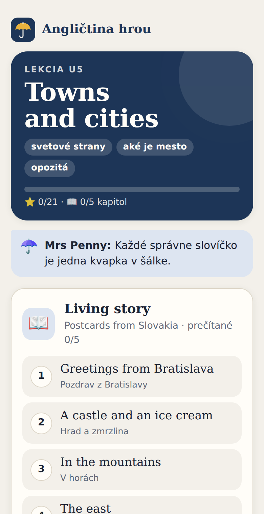

# Angličtina hrou

[](https://github.com/jurzon/anglictina/actions/workflows/validate.yml)

Angličtina pre slovensky hovoriacich žiakov: príbehy, v ktorých sa dá ťuknúť na každé slovo, a minihry ku každej lekcii z učebnice. Funguje v prehliadači na mobile aj počítači, bez inštalácie a bez registrácie.

### ▶ Hrať: https://jurzon.github.io/anglictina/

<p>
  
  
  
  
</p>

## Lekcie

| Lekcia | Téma | Slovná zásoba a gramatika |
|---|---|---|
| **U5** Towns and cities | Pohľadnice zo Slovenska, list z Yorku | svetové strany (*north of, in the east of*), prídavné mená a opozitá (*crowded – empty*), miesta v meste (*cathedral, harbour, town hall…*) |

## Hry

- 📖 **Living story**: príbeh v kapitolách. Ťuknutím na slovo sa ukáže preklad, podčiarknuté slová skrývajú otázku a na konci kapitoly sú otázky áno/nie.
- 📼 **Voicemail**: hráč počuje hlasový odkaz (text nevidí), napr. *„I'm in a city north of Prešov…“*, nájde mesto na mape a za odmenu dostane vtipný príbeh a výhru.
- 🗂️ **What is there to see?**: slovo padá a treba ho včas poslať do správnej skupiny (náboženské stavby, obchody, pamiatky, ostatné).
- 🔁 **Opposites**: spájanie opozít, každý správny pár naleje pohár, séria bez chyby robí combo.
- 🌊 **Opposite Lake**: slová sa na chvíľu vynoria z hladiny a treba chytiť pár, kým sa ponoria.
- 🔤 **Spell it!**: počúvanie hláskovania (*bee – are – eye – dee – gee – ee*), píše sa na papier alebo do appky.
- 🚦 **Karty** a 🧩 **Build the sentence**: gramatika s vysvetlením a skladanie viet.

Pokrok (hviezdy, prečítané kapitoly, séria dní) sa ukladá iba v prehliadači, appka nič neodosiela.

## Pre vývojárov

Čisté HTML, CSS a JavaScript bez buildu a bez závislostí.

```sh
python3 -m http.server 8000      # spustiť lokálne na http://localhost:8000
node tools/validate.mjs          # skontrolovať obsah lekcií
```

| Priečinok | Obsah |
|---|---|
| `js/` | engine, spoločný s repozitárom [taliancina](https://github.com/jurzon/taliancina) (zmeny treba preniesť aj tam) |
| `js/games/` | minihry; register je v `js/games/index.js` |
| `data/config.js` | jazyk, značka, maskot, texty hier |
| `data/index.js`, `data/unit*.js` | zoznam lekcií a ich obsah |
| `tools/validate.mjs` | kontrola obsahu (beží aj automaticky na GitHube pri každom pushi) |

**Nová lekcia:** pozri [docs/lekcia.md](docs/lekcia.md).

## Autor a licencia

Juraj Zonnenschein · jurzon@seznam.cz

Pre školy a nekomerčné učenie zadarmo, pozri [LICENSE](LICENSE). Texty príbehov sú pôvodné; učebnica slúži iba ako zdroj slovnej zásoby.
